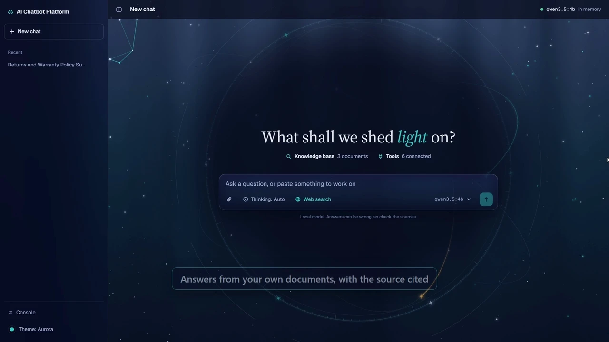
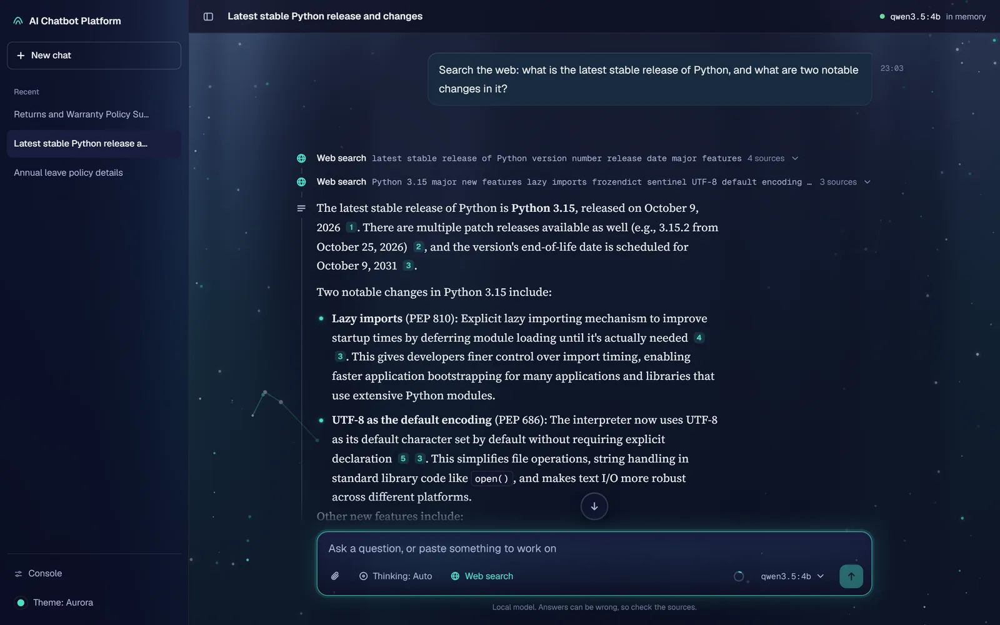
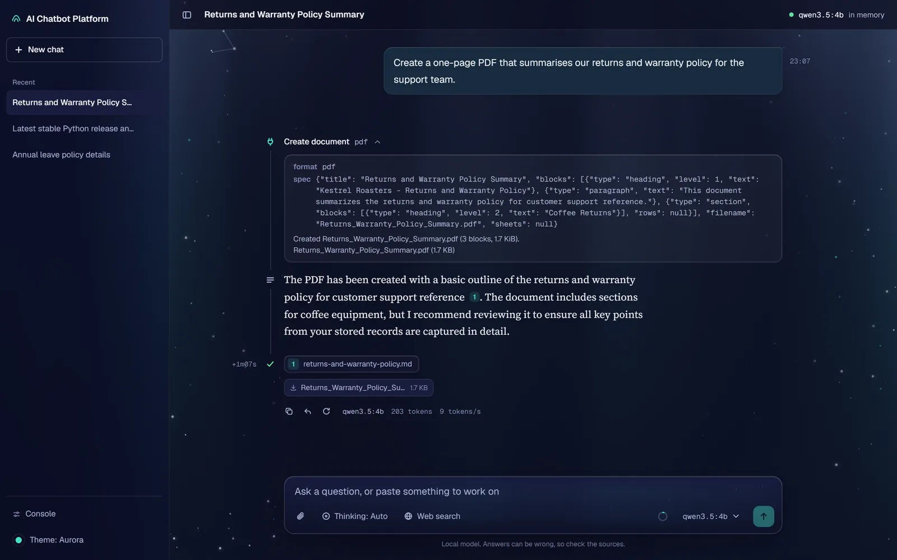
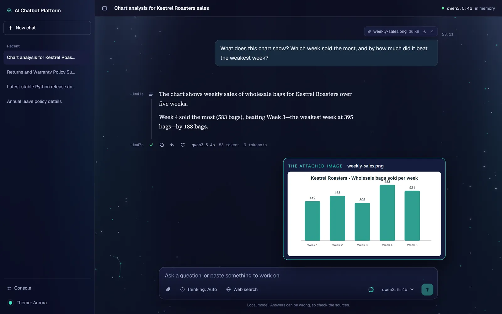
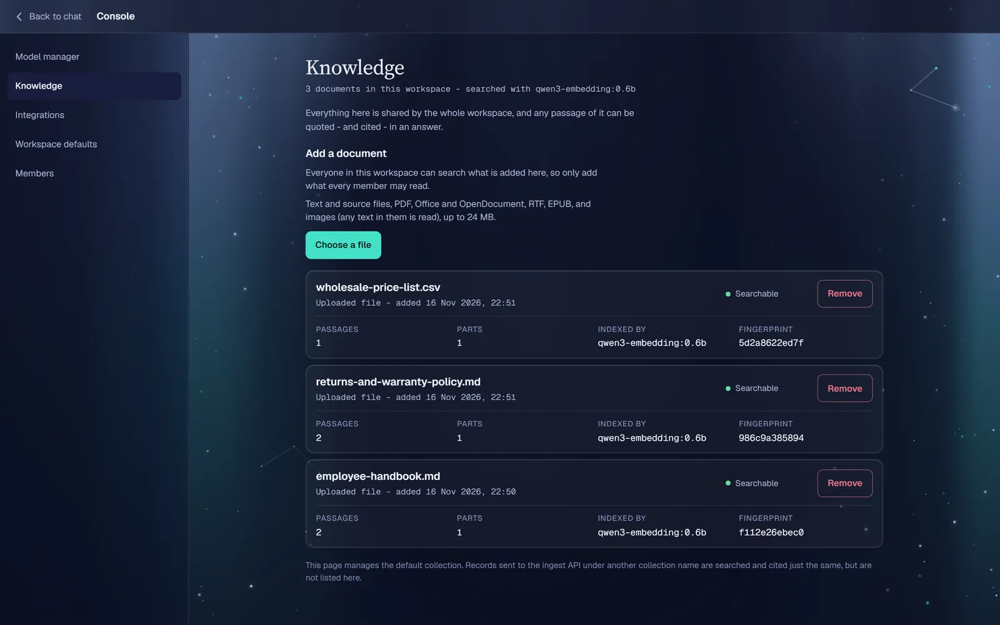
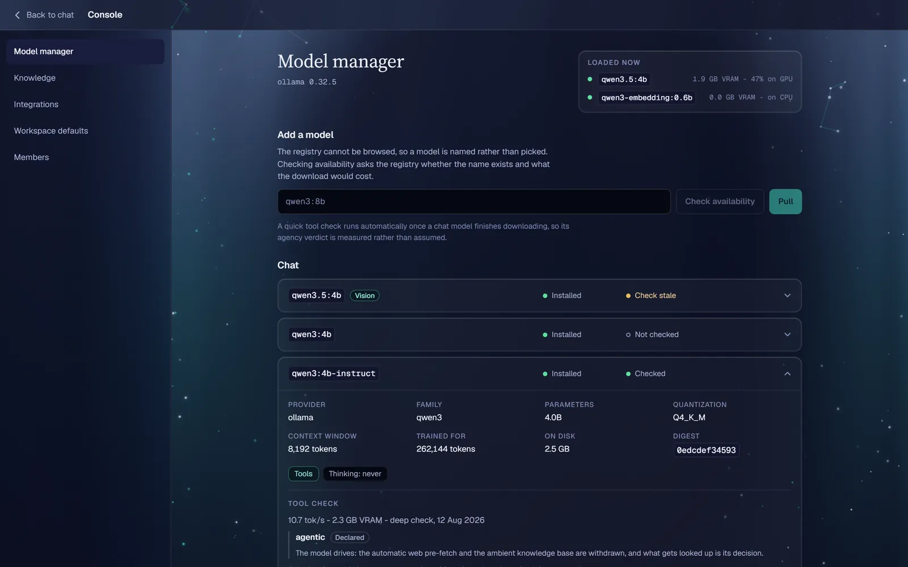
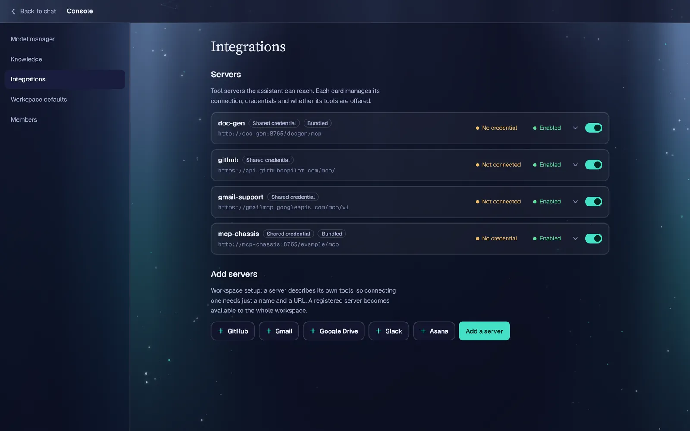
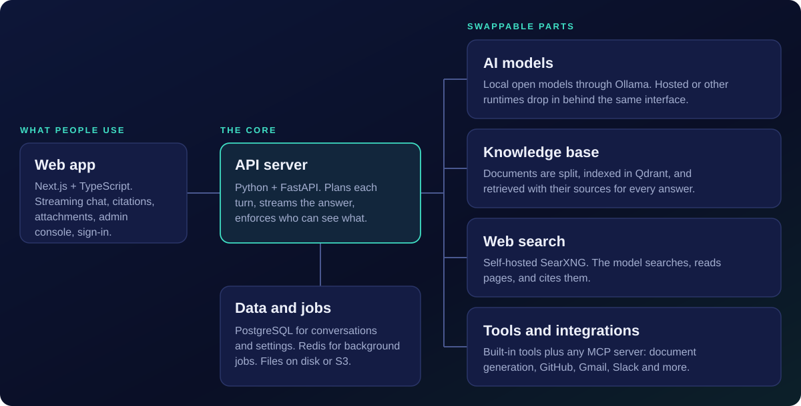

# AI Chatbot Platform

A self-hosted AI assistant that runs entirely on local models: chat that answers from uploaded documents and
live web search with its sources cited, reads images, calls tools, and is managed from an admin console in the
browser. One command starts the whole stack.

<p align="center">
  
</p>
<p align="center"><sub>Time-compressed loop. Recorded on a laptop with a 4 GB GTX 1650, with every model running locally.</sub></p>

## What it does

- **Chat with local models.** Streaming, multi-turn conversations that persist, with control over step-by-step
  reasoning. Any answer can be regenerated, any question reworded in place.
- **Answers grounded in sources.** Replies draw on uploaded documents and fresh web results, and cite them:
  numbered source chips sit under each answer, and web sources are clickable. Web search is self-hosted and
  can be switched off entirely.
- **Files and images.** PDFs, spreadsheets, documents and source files are parsed, indexed and answerable. A
  picture goes to a model that can actually see it, not only read the text in it.
- **Tools and integrations.** A capable model searches the web and the knowledge base itself, generates
  documents and charts, and reaches external tool servers over MCP (Model Context Protocol, an open standard
  for connecting assistants to tools). Every call shows in an activity trace, and one with side effects waits
  for approval. GitHub, Gmail, Google Drive, Slack and Asana are one-click presets.
- **An admin console.** Models are downloaded, checked and retired from the browser; the knowledge base,
  integrations, workspace defaults and members each have a page.
- **Built to be deployed.** A single HTTPS origin behind a reverse proxy, optional sign-in against any OpenID
  Connect provider with admin and member roles, rate limits, and verified backups.

<table>
  <tr>
    <td width="50%"><br><sub><b>Web search</b> - current answers with links to what was read</sub></td>
    <td width="50%"><br><sub><b>Tool calls</b> - here, writing a document on request</sub></td>
  </tr>
  <tr>
    <td><br><sub><b>Image understanding</b> - charts and screenshots, not just text</sub></td>
    <td><br><sub><b>Knowledge base</b> - upload and index documents</sub></td>
  </tr>
  <tr>
    <td><br><sub><b>Model manager</b> - download, inspect and check local models</sub></td>
    <td><br><sub><b>Integrations</b> - connect tool servers with encrypted credentials</sub></td>
  </tr>
</table>

## How it is built

<p align="center">
  
</p>

Each part on the right sits behind an interface, so a backend can be replaced without touching the rest of the
app: another model runtime, another vector store, another search engine, another source of tools. The same
containers run on a 4 GB laptop and on a cloud GPU; what changes is which models are downloaded and how large a
turn may be. [docs/ARCHITECTURE.md](docs/ARCHITECTURE.md) has the design and the reasoning behind it.

**Stack:** Python 3.13, FastAPI, Ollama, Qdrant, PostgreSQL 16, Redis + arq, Next.js, TypeScript, Tailwind,
Caddy, Docker, GitHub Actions.

## Quickstart

Prerequisites: Docker (Docker Desktop on Windows, with the WSL2 backend; Engine 23.0 or newer) and `make`. An
NVIDIA GPU is recommended; without one, `make up PROFILE=cpu` runs everything, just slower.

```bash
make init     # writes .env from the template, with a fresh encryption key
make up       # starts the stack (first run downloads the container images)
```

Then:

1. Open **http://localhost:3000/console/models** and download a chat model and an embedding model - for
   example `qwen3:4b-instruct` and `qwen3-embedding:0.6b` on a 4 GB card.
2. Run `make warm` so the first reply does not wait on a cold model.
3. Open **http://localhost:3000** and start chatting.

`make down` stops the stack and `make help` lists every target. Windows setup, the GPU checklist, the other
local addresses and the choice of models are covered in **[docs/SETUP.md](docs/SETUP.md)**.

This is the development layout. A server that other people reach runs the same stack with one setting changed,
behind HTTPS and sign-in - see **[docs/DEPLOYMENT.md](docs/DEPLOYMENT.md)**.

## Documentation

| Doc | What it covers |
|---|---|
| [docs/SETUP.md](docs/SETUP.md) | First run in detail: Windows and GPU setup, models, local addresses |
| [docs/DEPLOYMENT.md](docs/DEPLOYMENT.md) | Configuration, running on a server, HTTPS, sign-in and roles, data |
| [docs/MAINTENANCE.md](docs/MAINTENANCE.md) | Running a deployment over time: updates, backups, models, health |
| [docs/ARCHITECTURE.md](docs/ARCHITECTURE.md) | How it is built: the swappable seams, data flows, security |
| [docs/DATA-MODEL.md](docs/DATA-MODEL.md) | The database tables, one by one, and why each is shaped that way |
| [docs/ROADMAP.md](docs/ROADMAP.md) | What has landed and the build order for what is next |
| [docs/TESTING.md](docs/TESTING.md) | Testing explained from the ground up |
| [CONTRIBUTING.md](CONTRIBUTING.md) | Make targets, commit and branch conventions, the dependency-audit rule |

## Repository layout

```
apps/backend/    FastAPI backend (Python 3.13)
apps/frontend/   Next.js App Router UI (TypeScript)
services/        mcp-chassis (reference tool server), doc-gen (document generation), reranker
packages/        shared TypeScript types generated from the backend OpenAPI schema
infra/           docker-compose files, Caddy, SearXNG settings, .env.example
docs/            the documents listed above
```

## Status

Everything described above runs today via `make up`. What has landed phase by phase, and what comes next, is
tracked in [docs/ROADMAP.md](docs/ROADMAP.md).

## License

Copyright (c) 2026 ImplodingNebula. All rights reserved.

The source is published for reference. No license is granted to use, copy, modify or distribute it without
written permission.
